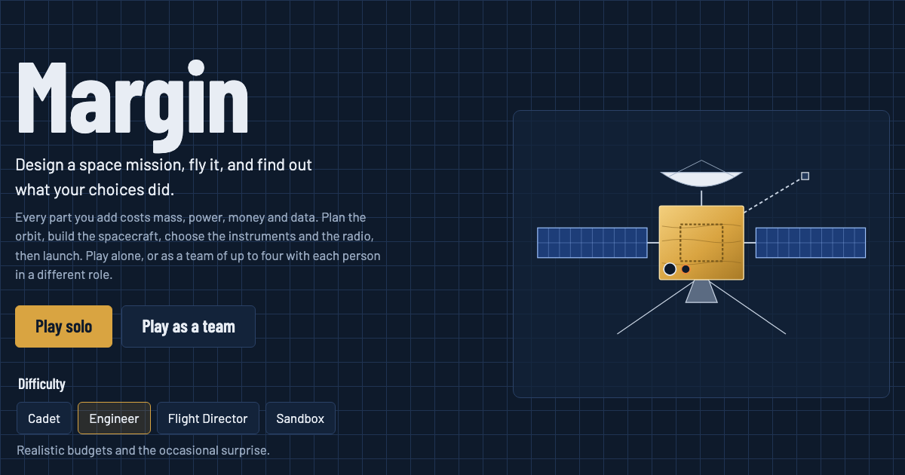

# Margin: design a space mission

**Play it:** https://aredwan-xyz.github.io/margin-mission-game/

Margin is a browser game about the trade-offs behind every space mission. Pick a mission,
choose the orbit and the rocket, build the spacecraft, pick the instruments and the radio,
pass a design review, then fly it and handle what goes wrong. Every part costs mass, power,
money and data, and every gauge shows how much margin you have left.

Built for the [NASA Space Apps Challenge 2026](https://www.spaceappschallenge.org/2026/challenges/space-mission-design-game/)
challenge *Space Mission Design Game*.



## What you do

1. **Choose a mission.** Four scenarios from beginner to advanced:
   - Wildfire Watch: Earth orbit
   - Lunar Ice Hunter: Moon orbit
   - Mars Weather Station: Mars orbit
   - Europa Ocean Explorer: Jupiter system

   Each has two objectives to choose from.
2. **Design it.** The design is split across four roles, each owning part of it:
   - **Mission Planner:** objective, orbit, route, launcher and testing
   - **Spacecraft Engineer:** spacecraft size, power, battery, propulsion, shielding and backups
   - **Science Lead:** instruments
   - **Communications Lead:** antenna and ground stations
3. **Pass the design review.** Every role sees its findings. A few problems stop the launch
   outright, such as being too heavy for the rocket or over budget. Most only hurt the
   mission, so you can choose to fly anyway and learn why.
4. **Fly it.** Watch development, launch, cruise, arrival and operations, and make decisions
   as surprises come up. Examples:
   - a supplier overrun
   - space debris
   - a lunar eclipse
   - a global dust storm on Mars
   - a stuck antenna
   - a possible water plume at Europa
   - whether to extend the mission
5. **Celebrate (or learn).** A launch countdown, rocket staging, and an animated view of the
   spacecraft at work, with effects for each event (dust storms, solar storms, debris,
   eclipses, plumes). Sound effects are optional.
6. **Read the report.** You get the outcome, a score breakdown, which role goals were met,
   and plain-language lessons tied to what actually happened, each with a true story from a
   real mission. Every flight earns a printable mission patch, and 16 badges reward
   different ways of playing, from saving money to surviving on a CubeSat.

## How it answers the challenge

| The challenge asks for | In Margin |
|---|---|
| Define an objective and requirements | Two objectives per mission, each with a stated requirement and science goal |
| Design the spacecraft and choose instruments | 11 component categories and 7 instruments, each with mass, power, cost and data |
| Choose a launcher and orbit, and check they fit | 5 launcher classes and 3 orbits per mission. The game checks capacity to that orbit and whether the rocket can reach it |
| Manage mass, power, budget, data, communications and time | Live gauges for each, with the margin shown as a hatched band, and a timeline of the mission's years |
| Every decision has a consequence | Changing any part updates every gauge, and each option shows its effect before you pick it |
| No single right answer | Each mission has several winning designs, checked by an automated search |
| Simulation, random events and evaluation | A seeded simulation with decisions, failures and a scored mission report |
| Teams of up to four with roles | Team mode gives each role an owner, a goal that pulls against the others, and a sign-off at the review |
| Difficulty levels and a sandbox | Cadet, Engineer, Flight Director and Sandbox |
| Explain why, in simple terms | Every warning explains its cause in plain words, with the numbers |
| Save, share and compare | Share links that rebuild a design exactly, plus a scoreboard on each device |

## The engineering model

Simplified and rounded, but each relationship moves the way real ones do.

- **Power:** solar output ∝ array area ÷ (distance from the Sun)². Arrays degrade each year,
  faster in radiation. The array must also recharge the battery for the dark part of each
  orbit. Nuclear sources (RTGs) give steady power anywhere and decay slowly.
- **Data:** rate ∝ transmitter power × antenna gain × ground-dish gain ÷ distance², capped
  by what the radio can handle. Data per day = rate × contact hours.
- **Propellant:** the rocket equation. Propellant = dry mass × (e^(Δv / (Isp·g₀)) − 1),
  with tank mass and a 10% Δv margin. Weak engines can make a trip impossible.
- **Launch:** each launcher has a capacity per orbit class. Gravity assists double what
  reaches Jupiter, but add three years.
- **Cost:** hardware + testing + launch + operations for every year in space + waiting
  for a launch window.
- **Risk:** launch failure, engine failure on arrival, and yearly electronics faults
  scaled by radiation, shielding, testing and backups.

All numbers live in [`js/data.js`](js/data.js). The checks and explanations are in
[`js/model.js`](js/model.js), and the simulation is in [`js/sim.js`](js/sim.js).

## Run it locally

No build step and no dependencies.

```bash
python3 -m http.server 8790
```

Then open http://localhost:8790.

Tests need Node 18 or later:

```bash
npm test
```

The tests check the physics relationships and that every mission has a design that usually
succeeds. They also check that the simulation always finishes, that seeds replay exactly,
and that share links round-trip.

## Sources

- NASA Space Apps 2026, [Space Mission Design Game](https://www.spaceappschallenge.org/2026/challenges/space-mission-design-game/)
- NASA, [Design and Develop Science Missions](https://www.nasa.gov/wp-content/uploads/2025/04/250323-design-and-develop-science-mission.pdf)
- NASA, [CubeSat 101](https://www3.nasa.gov/sites/default/files/atoms/files/nasa_csli_cubesat_101_508.pdf)
- JPL, [Concept Maturity Levels](https://dataverse.jpl.nasa.gov/dataset.xhtml?persistentId=hdl:2014/44299)
- NASA, [Systems Engineering Handbook](https://www.nasa.gov/reference/systems-engineering-handbook/)

Mission facts in the game come from public NASA mission histories: Galileo, Juno, Cassini,
Mars Reconnaissance Orbiter, Mars Climate Orbiter, Lunar Prospector, Lunar Reconnaissance
Orbiter, CAPSTONE, Dawn, Opportunity, and FIRMS.

## How AI was used

The game was designed and built with Claude, an AI assistant from Anthropic. It helped:

- draft the game design
- write the code, tests and text
- tune the numbers, using an automated search that checks each mission has several winning designs

A person directed the work and reviewed and played the result. Mission facts were kept to
well-documented public history.

## Licence and disclaimer

Code under the [MIT licence](LICENSE). Margin is an independent educational project. It is
not an official NASA product and is not endorsed by NASA or any agency named in it. All
numbers are simplified for teaching.
